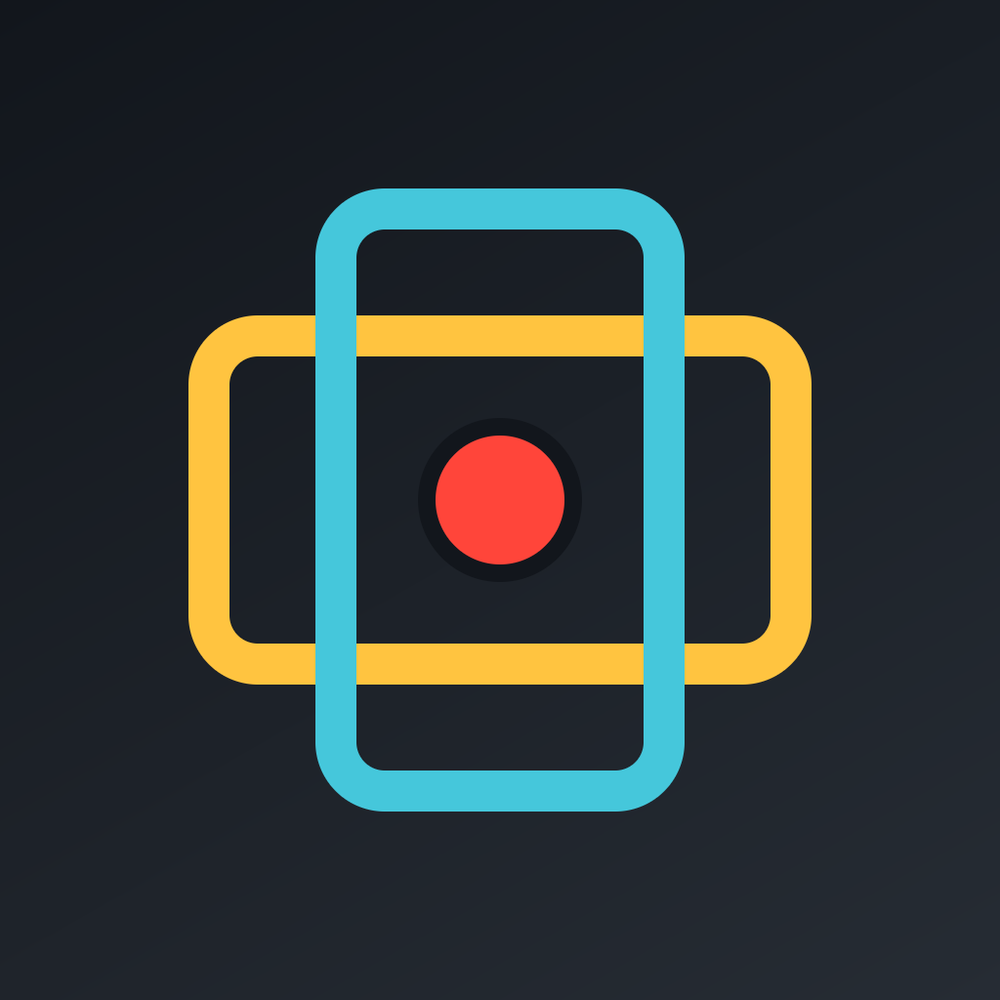
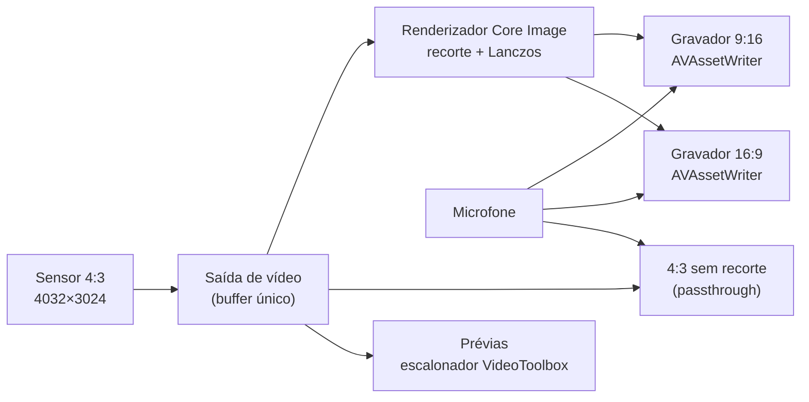

<div align="center">



# DualFrame

**Uma gravação. Vertical e horizontal ao mesmo tempo.**

Câmera profissional para iPhone que grava **9:16**, **16:9** e o **sensor 4:3 completo** a partir de um único quadro do sensor, em arquivos separados e perfeitamente sincronizados.

[](https://github.com/tfmoramora74-ship-it/DualFrame-/actions/workflows/build.yml)
[](https://github.com/tfmoramora74-ship-it/DualFrame-/releases/tag/latest)


[**Baixar o IPA**](https://github.com/tfmoramora74-ship-it/DualFrame-/releases/download/latest/DualFrame.ipa) · [Recursos](#recursos) · [Como funciona](#como-funciona) · [Instalação](#instalação) · [Compilar](#compilar-a-partir-do-código) · [Novidades](CHANGELOG.md)

</div>

---

## Por que o DualFrame

Quem publica no TikTok, Reels e Shorts **e** no YouTube costuma gravar a mesma cena duas vezes, uma em pé e outra deitada. O DualFrame grava uma vez só: o sensor captura um quadro 4:3 e o app recorta, em tempo real, um arquivo **vertical** e um **horizontal**, com o mesmo áudio e o mesmo instante, prontos para editar.

## Destaques

- 🎬 **Dois formatos, uma tomada:** 9:16 e 16:9 (mais o 4:3 do sensor inteiro, se quiser) do mesmo quadro, sincronizados quadro a quadro.
- 🔍 **Sensor completo, sem perda:** captura em 4032×3024 e redução com filtro Lanczos. Nada de imagem esticada ou serrilhada.
- 🎛️ **Controles manuais de verdade:** ISO, obturador, balanço de branco em Kelvin, foco manual e compensação de exposição, nas lentes físicas.
- 🤳 **Frente + trás:** grava a câmera traseira com a selfie numa janela que você arrasta e redimensiona, **no mesmo arquivo**.
- 🌌 **Longa exposição e astrofotografia:** empilhamento de quadros para céu noturno e rastros de luz.
- 📸 **Foto computacional:** processamento da Apple com RAW (DNG), fusão HDR multi-quadro e super-resolução (~27 MP).
- 🌡️ **Pensado para não esquentar:** prévias pelo escalonador de hardware e reação automática à pressão térmica da câmera.

## Recursos

### Vídeo

| Recurso | Detalhes |
|---|---|
| Formatos simultâneos | 9:16, 16:9 e 4:3 (sensor completo), cada um ligável à parte |
| Resolução por formato | HD, 4K ou **Nativa** (os pixels do recorte, sem escala) |
| Quadros por segundo | 24, 25, 30 e 60 |
| Cor | SDR, **HDR** (HLG 10-bit) e **Log** (Apple Log nos iPhones compatíveis; HLG nos demais) |
| Codecs | HEVC, H.264 e ProRes 422, com três níveis de bitrate |
| Estabilização | Padrão, Cinemática, Cinemática estendida e Máxima (iOS 18), com prioridade **Nitidez** ou **Estabilização** |
| Áudio | AAC compartilhado entre os arquivos, com medidor de nível |
| Orientação | A interface gira com o celular; os arquivos seguem como você segura o aparelho |

### Foto

| Modo | O que faz |
|---|---|
| **Apple** | Processamento do iPhone (Deep Fusion / Smart HDR), com opção **RAW (DNG)** do sensor inteiro |
| **Fusão HDR** | Rajada de 8 quadros alinhados e fundidos: menos ruído, sombras abertas, altas luzes preservadas |
| **Super-res** | Rajada de 10 quadros com micro-deslocamentos fundidos numa grade 1,5× (*shift-and-add*): cerca de 27 MP a partir de 12 MP |
| **Longa exposição** | 2 s a 60 s, em **Estrelas** (média, para astrofotografia) ou **Rastros de luz**, com foco no infinito automático |

Cada foto também sai em todos os formatos ligados (9:16, 16:9, 4:3).

### Ferramentas profissionais

- Lentes físicas `.5` / `1` / `2` / `3`, pinça para zoom e escolha manual do formato do sensor
- Toque para focar e **segure para travar AE/AF**
- **Zebra** (áreas estourando) e **focus peaking** (bordas em foco)
- Grade de terços, mira, **nível do horizonte** e histograma
- Temporizador de 3, 5 ou 10 s e disparo pelos **botões de volume**
- Tempo de gravação restante e aviso de temperatura
- Prévias **separadas** (vertical e horizontal) ou **tela cheia** com janela do outro formato

### Galeria

Grade por dia no estilo Google Fotos, pinça para mudar o tamanho da grade, filtros (Fotos, Vídeos, RAW), seleção múltipla, visualizador em tela cheia com zoom e troca entre os formatos de cada tomada. Tudo também fica visível no app **Arquivos** e pode ser copiado para o **Fotos**.

## Como funciona



1. **Um quadro, vários arquivos.** O sensor entrega um único buffer 4:3 por quadro. Cada formato é um recorte centralizado desse buffer, então todos ficam no mesmo instante.
2. **Sem rotação de pixels.** O buffer permanece na orientação do sensor; cada arquivo recebe a transformação que o deixa em pé na reprodução.
3. **Qualidade.** Os recortes passam os valores do sensor sem conversão de cor (exato em SDR, HLG e Log) e são reduzidos com Lanczos.
4. **Eficiência.** As prévias usam o escalonador de hardware e são desenhadas no tamanho real de cada janela. O app reage ao `systemPressureState` da câmera reduzindo trabalho antes que o iOS precise intervir.

Detalhes técnicos em [docs/ARCHITECTURE.md](docs/ARCHITECTURE.md).

## Instalação

O DualFrame é distribuído como IPA **sem assinatura**, para instalar pelo [LiveContainer](https://github.com/khanhduytran0/LiveContainer), que assina o app no próprio aparelho.

1. Baixe o [**DualFrame.ipa**](https://github.com/tfmoramora74-ship-it/DualFrame-/releases/download/latest/DualFrame.ipa), sempre da versão mais recente.
2. No LiveContainer, toque em **+** e escolha o arquivo.
3. Abra o DualFrame e permita câmera, microfone e (opcionalmente) Fotos.

> **Requisitos:** iPhone com iOS 17 ou mais novo. O modo frente + trás exige um iPhone com suporte a várias câmeras simultâneas (XS / XR ou mais novo).

## Compilar a partir do código

O projeto Xcode é gerado com o [XcodeGen](https://github.com/yonaskolb/XcodeGen) a partir de [`project.yml`](project.yml).

```bash
brew install xcodegen
xcodegen generate
open DualFrame.xcodeproj
```

Cada push na `main` dispara o [GitHub Actions](.github/workflows/build.yml), que compila em macOS, empacota o IPA sem assinatura e publica na release [`latest`](https://github.com/tfmoramora74-ship-it/DualFrame-/releases/tag/latest).

## Estrutura do projeto

```
DualFrame/
├── DualFrameApp.swift          Ponto de entrada e controle de orientação
├── Capture/
│   ├── CaptureEngine.swift     Sessão de captura (simples e multi-câmera), formatos, foto, rajada
│   ├── CameraModel.swift       Estado da interface e controles do dispositivo
│   ├── CaptureConfig.swift     Configurações persistidas
│   ├── CropMath.swift          Geometria dos recortes e orientação
│   ├── FrameRenderer.swift     Recorte/escala em Core Image e empilhamento
│   ├── TakeWriter.swift        Gravação simultânea (AVAssetWriter por formato)
│   ├── PhotoFusion.swift       Fusão multi-quadro e super-resolução
│   └── SelfieOverlay.swift     Janela da selfie no modo frente + trás
├── Support/                    Armazenamento das tomadas e nível
└── Views/                      Câmera, prévias, controles manuais, ajustes e galeria
```

## Limitações conhecidas

- **Estabilização em 4K:** em alguns iPhones (ex.: 13 Pro) o modo de sensor completo não estabiliza. Use HD com prioridade **Estabilização** para filmar andando.
- **Frente + trás:** a Apple limita esse modo a 30 fps e SDR, sem 4K. Ele grava apenas o formato vertical.
- **Apple Log:** só existe do iPhone 15 Pro em diante; nos demais, o modo Log grava em HLG 10-bit.

## Roadmap

- [ ] Timelapse nos dois formatos
- [ ] Lente dupla (grande-angular + ultra-angular, um formato em cada)
- [ ] LUTs de visualização para Log

---

<div align="center">
<sub>Feito com SwiftUI, AVFoundation, Core Image e VideoToolbox.</sub>
</div>
